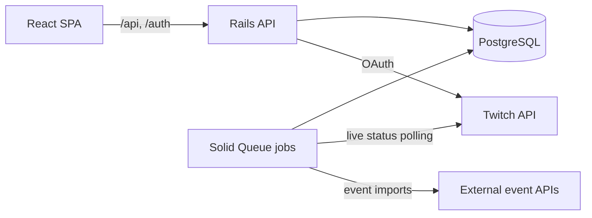

# Speedrun Hub FR

[](https://github.com/YoanHernalesteen/speedrun-hub-fr/actions/workflows/ci.yml)


A directory of French speedrunners and speedrun organizations: member profiles, live Twitch status, upcoming community events and a private space for organization leads.

> **Status:** early development. See the [roadmap](#roadmap) for progress.

## Features

- **Directory** of speedrunners and organizations, with search
- **Live badge** showing which members are currently streaming on Twitch
- **Upcoming events** aggregated from several external APIs
- **Leads space**: a discussion area restricted to organization leads
- **Sign in with Twitch** (OAuth), no password to manage

## Screenshots

_Coming soon._

## Tech stack

| Area     | Tools                                                                           |
| -------- | ------------------------------------------------------------------------------- |
| Backend  | Ruby 4.0, Rails 8.1 (API only), PostgreSQL, Solid Queue, Pundit                 |
| Frontend | React 19, TypeScript (strict), Vite, React Router, TanStack Query, Tailwind CSS |
| Testing  | RSpec, FactoryBot, Vitest, Testing Library                                      |
| Quality  | RuboCop (Rails Omakase), oxlint, Prettier                                       |
| Security | Brakeman, bundler-audit, npm audit, Dependabot                                  |
| CI/CD    | GitHub Actions, Kamal (planned deployment to a VPS)                             |

## Architecture



Monorepo with two apps:

- [`backend/`](backend): Rails in API-only mode
- [`frontend/`](frontend): React single-page app

Key design decisions:

- **Single origin, no CORS.** In development the Vite dev server proxies `/api` and `/auth` to Rails; in production Rails serves the compiled SPA.
- **Cookie-based sessions.** Rails owns authentication (Twitch OAuth via OmniAuth); the SPA asks `GET /api/me` who the current user is. No tokens stored in the browser.
- **Authorization on the server.** Every rule lives in Pundit policies, which deny by default; the frontend only adapts the UI.
- **Live status read from the database.** A background job polls Twitch and stores who is live, so page views never hit the Twitch API directly.
- **One adapter per event source**, with deduplication on `source` + `external_id`.

## Getting started

### Prerequisites

- Ruby 4.0.9 (see [`backend/.ruby-version`](backend/.ruby-version))
- Node.js 24
- Docker (for the local PostgreSQL database)

### Backend

```sh
cd backend
docker compose up -d          # PostgreSQL on port 5433
bin/setup --skip-server       # install gems and prepare the database
bin/rails server              # http://localhost:3000
```

### Frontend

```sh
cd frontend
npm install
npm run dev                   # http://localhost:5173
```

## Tests and quality checks

The same checks run in CI on every push and pull request.

```sh
# Backend
cd backend
bundle exec rspec
bin/rubocop
bin/brakeman
bin/bundler-audit

# Frontend
cd frontend
npm run test:run
npm run lint
npm run format:check
npm run build                 # type-check and build
```

## Roadmap

- [x] Project setup (Rails API + Vite React, testing, linting, CI)
- [ ] Core models and first screen (organizations list)
- [ ] Sign in with Twitch
- [ ] Searchable directory
- [ ] Twitch polling job and live badge
- [ ] Event source connectors
- [ ] Leads discussion space

## License

Copyright © 2026 Yoan Hernalesteen. All rights reserved.
